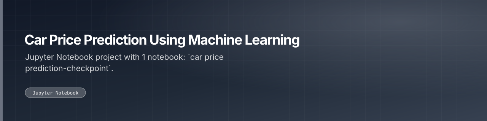

Notebook predicting used-car resale prices from vehicle attributes with regression models.

 

 

---

## What this is

A regression exercise predicting used-car prices from vehicle attributes, worked end to end in a single notebook.

|  |
|:--:|
| **1** |
| docs |

---

<a href="https://github.com/gowtham-creator/car-price-prediction-using-machine-learning">gowtham-creator/car-price-prediction-using-machine-learning</a>

